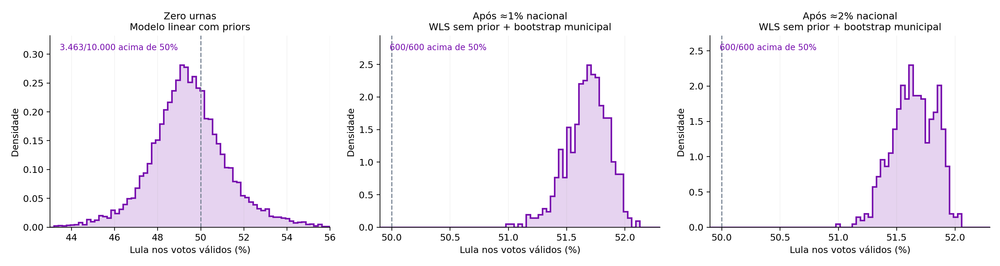
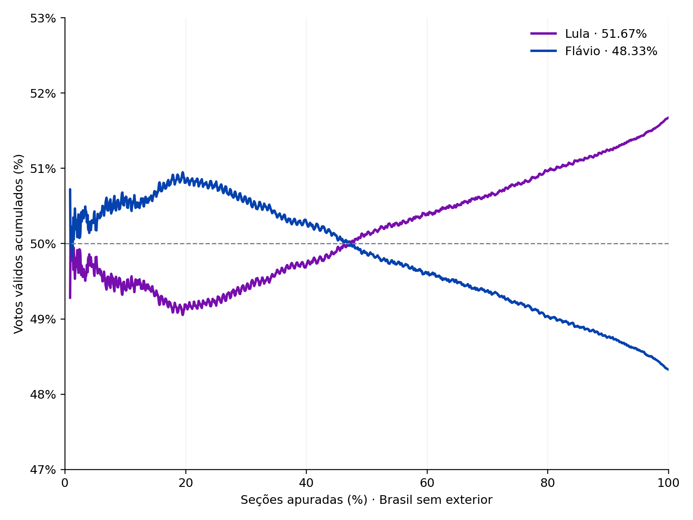

# Previsão eleitoral antes e durante a apuração

**Victor Rangel · Econometria Fácil**

Uso um **modelo linear para projetar o segundo turno a partir do primeiro**. Antes das urnas, faço previsão a priori com coeficientes probabilísticos; depois, ajusto os coeficientes aos votos disponíveis:

| Informação disponível | De onde vêm os coeficientes? | Como gero as previsões? |
|---|---|---|
| Zero urnas do segundo turno | Priors informados pela Quaest e por hipóteses de participação | Previsão a priori do modelo linear: aplico 10.000 matrizes sorteadas ao primeiro turno |
| Primeiras urnas do segundo turno | Estimação por mínimos quadrados ponderados com restrições, ou WLS | Estimo a regressão e faço 600 reestimações por bootstrap municipal |

**Com zero urnas, o modelo linear já produz previsões.** Seus coeficientes vêm dos priors e ainda não foram ajustados a votos observados do segundo turno. Aplico cada matriz ao primeiro turno e obtenho a distribuição das projeções: média de 49,47% e 3.463/10.000 cenários acima de 50% (34,63%). Não há uma regressão adicional estimada nem uma etapa descartada. Depois das primeiras urnas, estimo os coeficientes por WLS só com os votos disponíveis no corte, sem Quaest. Essa implementação não faz uma atualização bayesiana integral entre as duas etapas.

É uma reconstrução retrospectiva de 2026, com implementação própria inspirada nas explicações de Rodrigo Mahlmeister. Os horários limitam os votos de cada ajuste, mas os extratos vieram de arquivos finais. A especificação foi escolhida conhecendo o desfecho; este exercício não equivale a uma previsão registrada ao vivo.

## Rodar o projeto

Use Python 3.12. Não precisa de chave de API nem de baixar os microdados completos.

```bash
git clone https://github.com/vr-rodrigues/regressao-eleitoral-quaest.git
cd regressao-eleitoral-quaest
python -m venv .venv
```

Ative o ambiente:

```powershell
# Windows PowerShell
.venv\Scripts\Activate.ps1
```

```bash
# macOS ou Linux
source .venv/bin/activate
```

Instale as dependências e execute:

```bash
python -m pip install -r requirements.txt
python reproduzir.py --verificar
```

O programa recalcula os coeficientes, gera as previsões e salva tabelas e gráficos em `resultados/`. A opção `--verificar` confere os números publicados **depois do cálculo**. A referência não entra na simulação nem na estimação.

Para rodar uma etapa isolada:

```bash
python reproduzir.py --corte 0 --saida resultados/zero
python reproduzir.py --corte 1 --saida resultados/um
python reproduzir.py --corte 2 --saida resultados/dois
```

O corte 0 funciona sem os arquivos de apuração. Os cortes 1 e 2 funcionam sem a Quaest e sem o histórico de participação; o corte 1 também não abre os dados de 2%.

## Resultados

Os placares projetados consideram o **Brasil sem exterior**. O avanço que define os cortes é nacional, incluindo o exterior.

| Corte nacional | Seções domésticas | Média de Lula nos válidos | Faixa central de 95% | Resultados acima de 50% |
|---|---:|---:|---:|---:|
| Zero urnas | 0 | 49,47% | 45,65% a 53,65% | 3.463/10.000 = 34,63% |
| Menos de 1%: 0,9984% | 4.208 | 51,67% | 51,28% a 51,98% | 600/600 |
| Aproximadamente 2%: 1,9994% | 9.205 | 51,65% | 51,30% a 51,95% | 600/600 |

Os cortes são de **25/10/2026, às 19:04:21 e 19:16:39**, nos horários registrados pelo TSE. Cada arquivo contém apenas as seções observadas até seu corte. O resultado final não entra nos arquivos de dados usados pelo modelo. O PDF o apresenta separadamente para avaliação.



Os painéis têm escalas próprias. O recorte do gráfico inicial omite algumas caudas; médias, faixas e frequências usam todos os resultados calculados.

## Como funciona a conta

Cada seção tem cinco grupos de origem no primeiro turno: Lula, Flávio, outros candidatos, branco/nulo e ausências. Para prever os votos de um candidato, multiplico o tamanho de cada grupo por seu coeficiente e somo:

```text
votos previstos = soma de (eleitores da origem × coeficiente para o candidato)
```

A relação é linear nos coeficientes nas duas etapas. Com zero urnas, uso priors para gerar esses coeficientes e prever. Com urnas, estimo-os por WLS. As explicativas do primeiro turno, sozinhas, não ajustam os coeficientes que ligam os dois turnos. Uso a mesma matriz em todas as seções, sem intercepto adicional e sem efeitos fixos de município ou UF.

Com a apuração em andamento, mantenho fixos os votos contados e prevejo só as pendências:

```text
total previsto = votos já contados + votos previstos nas seções pendentes
Lula nos válidos (%) = 100 × total de Lula / (total de Lula + total de Flávio)
```

Os **34,63%** são a frequência dos cenários iniciais em que Lula supera 50%. Dependem do prior e das hipóteses de participação; não são uma probabilidade publicada pela Quaest.

Para o bootstrap, sorteio municípios com reposição e mantenho suas seções juntas. Reestimo a regressão em cada amostra e calculo uma nova previsão nacional. No corte de menos de 1%, cada sorteio tem 330 municípios; no de aproximadamente 2%, tem 905. **600/600** significa que Lula supera 50% nas 600 reestimações calculadas. Isso não elimina erros compartilhados pelos ajustes ou o risco de extrapolar para lugares ainda ausentes.

Os [detalhes do método](docs/METODO.md) explicam as variáveis, a Quaest, a Dirichlet, a participação e a regressão, com equações e exemplo numérico.

## A trajetória da apuração



Para desenhar as curvas, também preciso supor a ordem em que as seções pendentes chegam. Recebo essa ordem como insumo, construída com o ritmo de 2022, a cronologia do primeiro turno de 2026 e a informação disponível no corte. O programa recalcula os votos previstos e os acumula nessa ordem.

Não entram votos futuros do segundo turno. A curva depende da ordem hipotética e não prevê com precisão validada o momento da virada. O percentual final independe da ordem da soma.

## O que mudou em relação à primeira versão

Inicialmente, mantinha o prior Quaest como penalização também depois das primeiras urnas. Ao retirá-lo, as médias ficaram próximas: **51,671% para 51,674%** no corte de menos de 1%; **51,643% para 51,645%** no de aproximadamente 2%. Nesse teste, os dados observados já dominavam a previsão nacional. A versão atual mantém a Quaest apenas na previsão a priori do modelo linear, com zero urnas. Essa revisão simplifica o ajuste, sem um ganho relevante de acurácia sobre a versão anterior.

Esta revisão esclarece a descrição do método, **sem mudar coeficientes, sorteios ou resultados**. O [PDF técnico v30](docs/artigo_modelo_linear_priors_v30.pdf) mantém também a análise histórica de incerteza de v29; as faixas da tabela acima continuam sendo as distribuições originais. O piso histórico amplia intervalos sem gerar novos sorteios ou validar os 34,63% iniciais.

Monte Carlo é a técnica usada para simular os cenários; não é uma alternativa incompatível com regressão. Este exercício não demonstra superioridade geral de uma família de modelos.

O [texto da comunidade com as seis imagens](docs/comunidade/TEXTO.md) apresenta a mesma explicação em linguagem mais conversada.

## Arquivos e saídas

| Arquivo | Função |
|---|---|
| `reproduzir.py` | Lê os dados de cada corte, executa o cálculo e salva as saídas |
| `modelo.py` | Sorteia coeficientes com priors ou estima WLS com os votos do corte |
| `graficos.py` | Desenha distribuições e trajetórias |
| `test_reproducao.py` | Confere integridade dos dados, isolamento dos cortes e saídas |
| `dados/` | Extratos eleitorais, pesquisa, histórico e ordens hipotéticas |
| `referencia.json` | Valores usados apenas pela opção `--verificar` |

Em `resultados/`, `previsoes.csv` resume os placares; `cenarios_0pct.csv`, `cenarios_1pct.csv` e `cenarios_2pct.csv` guardam cada previsão. `coeficientes.csv` identifica a origem dos coeficientes, suas médias e os quantis.

Os arquivos `coeficientes_*pct.npz` guardam as matrizes em `beta` e sua média em `beta_media`. **`beta_pontual` só existe nos cortes com urnas**, em que houve estimação. Com zero urnas, a coluna correspondente no CSV fica vazia.

Para executar as verificações:

```bash
python -m unittest -v
```

As fontes e os hashes estão em [`dados/fontes.json`](dados/fontes.json). Dados eleitorais são atribuídos ao TSE e a pesquisa, à Quaest. A licença MIT cobre meu código, sem transferir direitos sobre os materiais das fontes.
