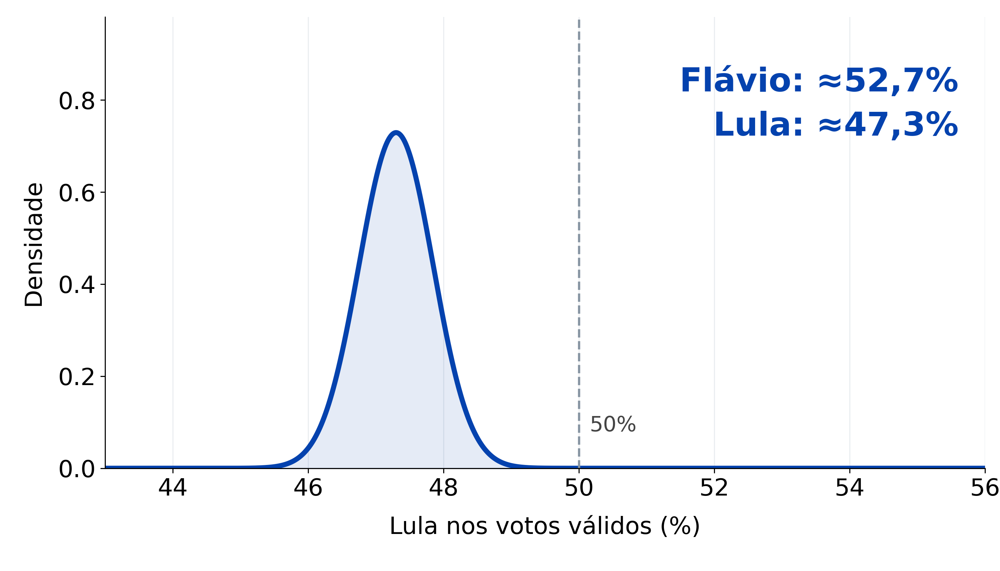
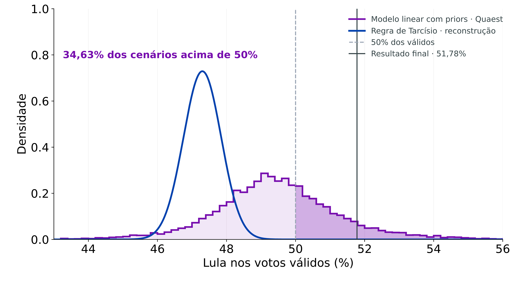
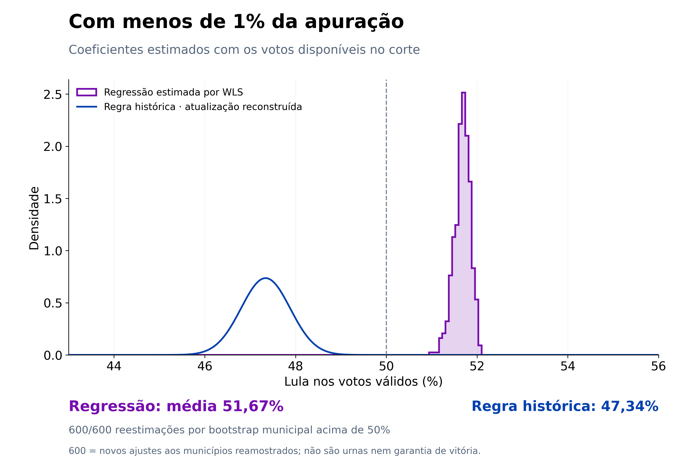
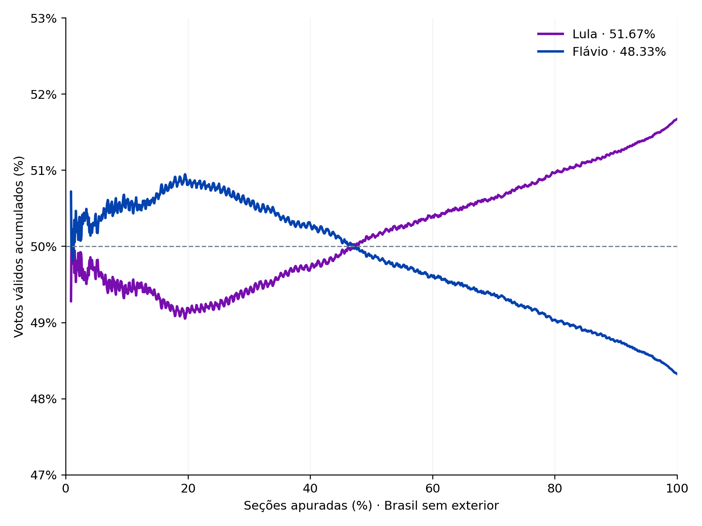
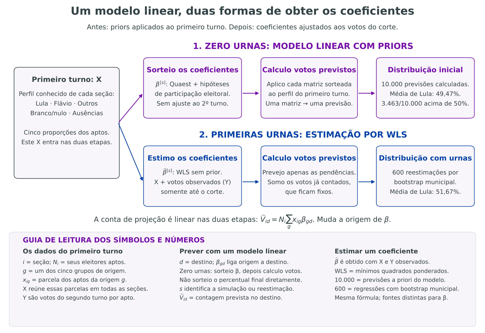
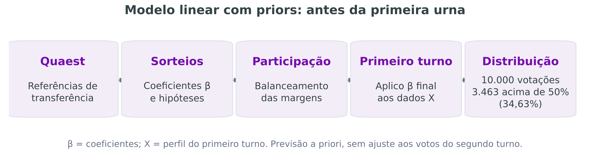

# Flávio era tão favorito assim?

Victor Rangel · Econometria Fácil

Quem me acompanha sabe que eu não estava tão ativo durante o período eleitoral. Muito porque seria fácil descambar para uma disputa apenas político-partidária dentro do perfil, e eu teria odiado isso. Mas existe um interesse grande pelas modelagens estatísticas e econométricas de eleições, então cá estou eu trazendo material para vocês. Estou aprendendo também, então vamos construindo juntos.

O governador de SP, Tarcísio de Freitas, se aventurou a apresentar seus cálculos em um vídeo. Na conta dele, Flávio aparecia perto de 52,7% dos votos válidos. A faixa central de 90% ia de 51,8% a 53,6%, toda acima de 50%. Olhando aquela curva, a vitória de Lula parecia um cenário muito remoto.

A lógica era partir do primeiro turno de 2026 e usar os ganhos entre os turnos de 2022, por estado, para projetar quanto cada finalista receberia. Eu reconstruí essa regra e aproximei a curva pelos números divulgados no vídeo. Não tive acesso à planilha nem aos sorteios originais. Ficou assim:

Desde o primeiro momento, o que ele mostrou me pareceu simplório para sustentar uma confiança tão grande na vitória de Flávio. Minha impressão foi de uma peça de otimismo político, com o governador na posição de professor mostrando que sabe matemática, enquanto as hipóteses por trás daquela previsão ficavam em segundo plano. Dito isso, achei que valia abrir a conta e testar o que aconteceria com outras hipóteses.

Separei minha reconstrução retrospectiva em duas etapas, usando uma estrutura linear de previsão nas duas. Com zero urnas do segundo turno, usei um modelo linear com priors: os dados do primeiro turno entram na conta e os coeficientes vêm de distribuições informadas pela Quaest e por hipóteses de participação. Depois dos primeiros votos, estimei os coeficientes por regressão para prever as seções pendentes.

Com 0% apurado, eu já conhecia o perfil do primeiro turno de cada seção. O que ainda não tinha eram votos do segundo para ajustar os coeficientes. Então sorteei esses coeficientes a partir dos priors e apliquei cada conjunto ao primeiro turno. Multiplico o tamanho de cada grupo pelo coeficiente correspondente e somo os votos previstos. Uma matriz sorteada, uma previsão. Repeti 10.000 vezes e formei a distribuição inicial. Essa é a previsão a priori do modelo linear; não há uma regressão adicional estimada com zero urnas.

Nesse primeiro exercício, Lula superou 50% em 3.463 dos 10.000 cenários: 34,63%, cerca de um em cada três. A média prevista era 49,47%. Flávio continuava favorito, mas havia uma chance considerável de o resultado ir para o outro lado.

Por que usei a Quaest? Gosto do nome. Mas fica aí o exercício de testar outros institutos que vocês conhecerem. A ideia é entender o que muda quando mudamos as hipóteses.

O eixo horizontal mostra a votação projetada de Lula entre os válidos. Na curva roxa, a área à direita de 50% reúne os cenários em que ele vence. Esses 34,63% são do meu modelo e das escolhas que fiz, não uma probabilidade publicada pela Quaest. A distribuição representa as incertezas dos coeficientes e da participação que coloquei na conta; ela não garante que todos os riscos eleitorais estejam cobertos. A linha do resultado final está ali só para comparar depois.

Depois entram os primeiros votos. No corte de 0,9984% das seções nacionais, havia 4.208 seções domésticas de 330 municípios. Com essas respostas observadas do segundo turno, ajustei os coeficientes por mínimos quadrados ponderados, ou WLS. Usei só os votos disponíveis naquele corte, sem Quaest nem calibração histórica de participação. Os votos contados ficaram na soma; o modelo previu apenas o que faltava.

A média de Lula passou a 51,67%, com faixa central de 95% do bootstrap original entre 51,28% e 51,98%. Ele ficou acima de 50% nas 600 reestimações por bootstrap municipal.

Essas 600 reestimações são o seguinte: em cada repetição, sorteio 330 municípios com reposição. Alguns aparecem mais de uma vez, outros ficam de fora. Cada município leva suas seções, e estimo a regressão novamente. Prevejo as pendências com os novos coeficientes e somo aos votos contados, que ficam fixos. São 600 previsões nacionais usando o mesmo corte de informação.

Os 600/600 significam que Lula passou de 50% em todas essas previsões. Isso depende do modelo: elas ainda podem compartilhar o mesmo erro, principalmente se os lugares que faltam tiverem um comportamento diferente dos que chegaram primeiro.

Na primeira versão, mantinha o prior da Quaest também depois das primeiras urnas. Retirei essa penalização e a média passou de 51,671% para 51,674%, praticamente igual. Os dados observados já dominavam a previsão nacional nesse corte. Por isso, deixei a Quaest só na previsão a priori do modelo linear, com zero urnas. Depois, uso WLS sem prior. São dois procedimentos de obtenção dos coeficientes; não estou fazendo uma atualização bayesiana integral entre eles. Vivendo e aprendendo!

Também atualizei minha reconstrução da regra histórica: substituí previsões por votos contados e mantive as taxas de 2022 nas pendentes. O centro de Lula mudou de 47,30% para 47,34%. Essa atualização é minha; não sei se Tarcísio faria assim. Já a regressão aprende com as primeiras urnas as relações que aplica ao restante do país.

O resultado doméstico final foi 51,78%. A projeção com menos de 1% ficou a cerca de 0,1 ponto percentual dele. Foi um resultado próximo nesse exercício; para falar em superioridade geral, precisaríamos testar outras eleições. E a comparação não é “regressão contra Monte Carlo”: eu também uso Monte Carlo para gerar os cenários iniciais. O que muda são as informações e as hipóteses de cada modelo.

Também projetei o placar acumulado, para ver como a liderança poderia mudar. Mantive os coeficientes desse corte e acrescentei uma hipótese de ordem de chegada, baseada no ritmo de 2022 e na cronologia do primeiro turno de 2026. Nessa parte, me inspirei bastante no Rodrigo Mahlmeister. Estou aprendendo com o trabalho dele também; a implementação aqui é minha.

O eixo horizontal mostra o avanço da apuração e o vertical, o placar acumulado nos válidos. Nessa ordem hipotética, a última passagem de Lula à frente aparece perto de 47% das seções domésticas. As curvas terminam em 51,67% para Lula e 48,33% para Flávio.

Esses resultados são projetados usando o mesmo corte de menos de 1% da apuração nacional. Nenhum voto posterior foi acrescentado para desenhar o caminho. A ordem de chegada é uma hipótese, e sua incerteza não está incluída nessas curvas.

E como funciona esse modelo linear?

Cada seção é uma linha da base. Dividi seus aptos do primeiro turno em cinco grupos: Lula, Flávio, outros candidatos, branco/nulo e ausências. Suas parcelas são as explicativas, x. Os coeficientes, β, transformam esse perfil em votação prevista; multiplicar a previsão em proporções pelos aptos dá o número de votos. Usei coeficientes nacionais, sem efeitos fixos de estado ou município.

A fórmula de previsão é a mesma nos dois momentos. Antes das urnas, o modelo linear recebe coeficientes sorteados dos priors. Com as primeiras urnas, recebe coeficientes estimados por WLS, os mínimos quadrados ponderados. Para quem, como eu, vem da econometria frequentista, a diferença é essa: especificar uma relação linear e fazer previsões com ela não exige que eu já tenha estimado seus coeficientes por mínimos quadrados. Com zero urnas, são os priors que representam o que sei e o que suponho sobre esses valores. Os 34,63% já vêm dessa aplicação ao primeiro turno.

Na simulação inicial, considero quatro destinos: Lula, Flávio, branco/nulo e ausência. Com urnas, estimo apenas Lula e Flávio. Os coeficientes são não negativos e sua soma por origem não passa de um. O restante reúne branco/nulo e ausência. Essas relações entre seções não identificam como cada pessoa mudou seu voto.

Para construir os priors, parti das transferências da Quaest. Entre os eleitores dos demais candidatos, 37% declaravam Lula e 43%, Flávio. Usei uma distribuição Dirichlet para sortear proporções positivas que somam um, em vez de tratar as taxas da pesquisa como valores conhecidos com certeza.

Os parâmetros são as taxas multiplicadas por 100, mais 0,5 por destino: 37,5 para Lula e 43,5 para Flávio. O 100 foi minha escolha de concentração dos sorteios, não o tamanho da amostra da pesquisa.

Também sorteei a divisão dos destinos restantes e quanto do apoio declarado por ausentes e eleitores de branco/nulo viraria voto. Calibrei a participação com as mudanças entre turnos de 2014, 2018 e 2022, sem impor uma votação aos candidatos. Tudo isso entra só na etapa sem urnas.

Em cada sorteio, aplico os coeficientes ao primeiro turno e somo os votos previstos. No primeiro cenário preservado, Lula ficou com 48,4731%; no segundo, com 50,4521%. Repeti a conta 10.000 vezes e contei os 3.463 resultados acima de 50%. É daí que saem os 34,63%.

Mudar a dispersão do prior muda essa frequência. Nos testes, a concentração 25 produziu 41,26% de cenários favoráveis a Lula; a concentração 400, 29,04%. Por isso faço questão de mostrar as escolhas junto do resultado.

Nenhum voto posterior ao corte entrou no ajuste, mas a escolha entre especificações foi feita retrospectivamente, conhecendo o desfecho. Os placares se referem ao Brasil sem exterior, enquanto o percentual de apuração usado para definir o corte é nacional. Também não tive acesso ao código original do Mahlmeister.

No PDF completo, que acompanha este texto (anexo no primeiro comentário), deixei as equações, um exemplo numérico dos priors e os testes. Ele também traz a verificação histórica da incerteza e uma ampliação das faixas, sem mudar os centros ou os 600 ajustes originais. Essa verificação não valida automaticamente os 34,63% antes das urnas. O código e os dados estão no GitHub para quem quiser refazer as contas e testar outras escolhas.

Vou continuar em mais dois textos: um abrindo as previsões e os erros por região; outro testando cargos como governador, senador e deputados. A ideia é ir dividindo essa investigação com vocês.
